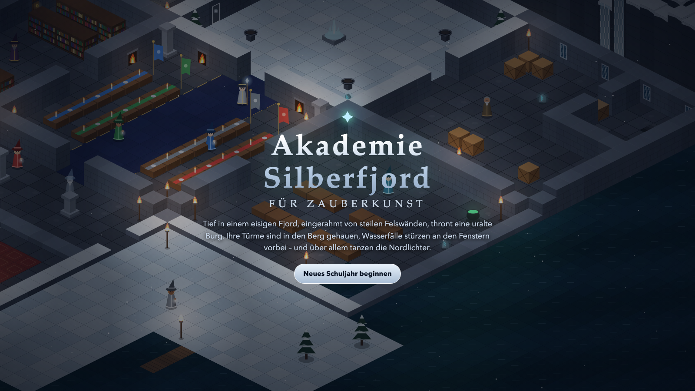
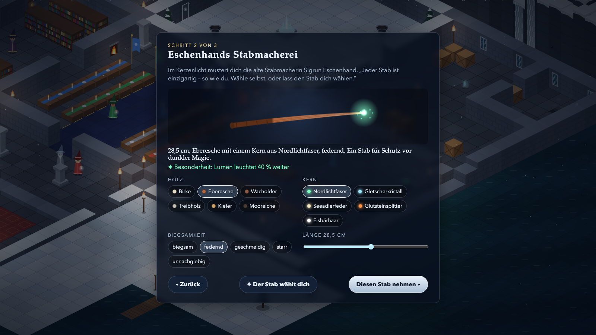
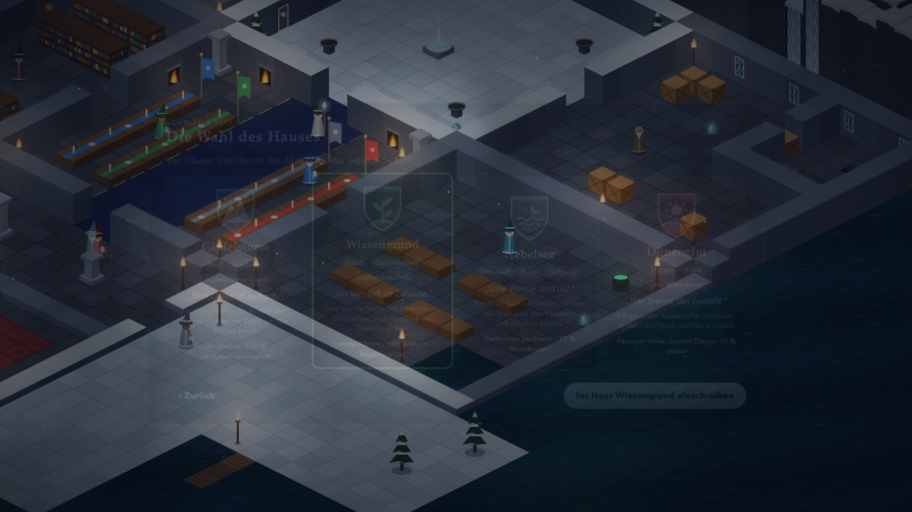
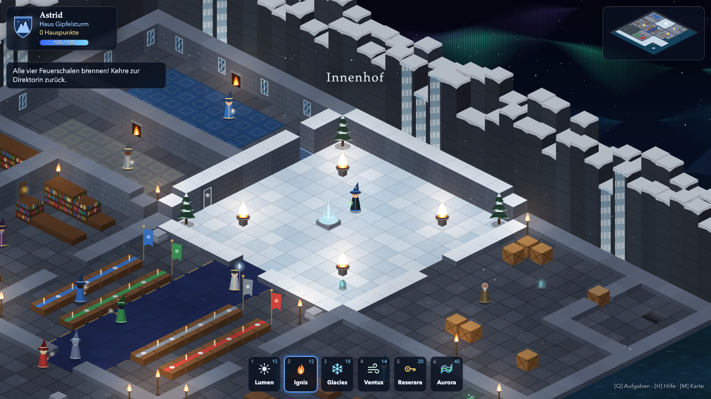
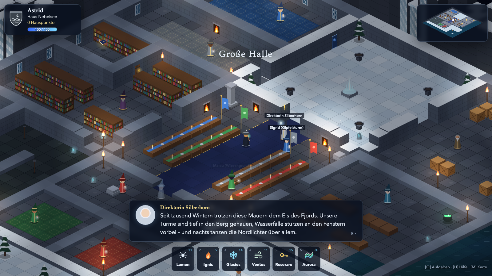
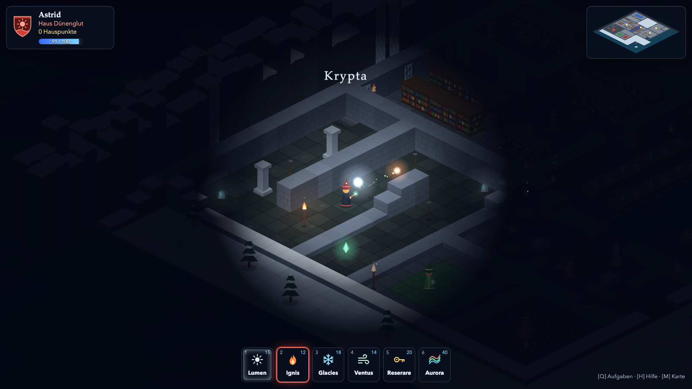
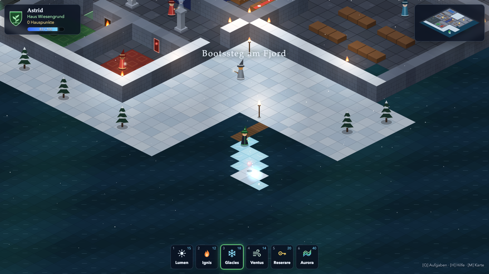
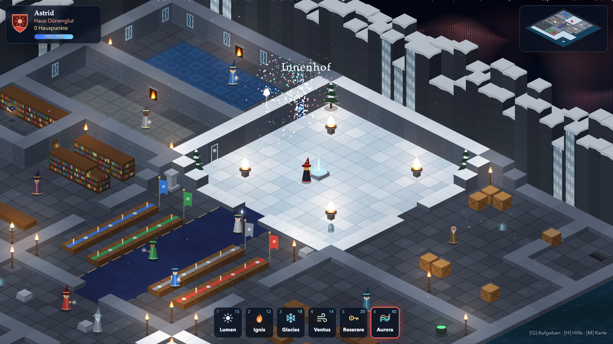

# Akademie Silberfjord für Zauberkunst

[Spiel im Browser](https://mkrgr.github.io/wizardpeople/)

Ein isometrisches Browsergame: Du bist neu an einer Zauberschule in einer uralten Burg tief in einem eisigen Fjord. Steile Felswände rahmen sie ein, die Türme sind in den Berg gehauen, Wasserfälle stürzen an den Fenstern vorbei, und über allem tanzen die Nordlichter.



## Starten

Öffne `index.html` in einem aktuellen Browser (Chrome, Firefox, Safari oder Edge):

```sh
open index.html
```

Du brauchst weder Server noch Build-Schritt, Abhängigkeiten oder Internetverbindung. Grafiken, Schriften und Klänge werden lokal erzeugt bzw. kommen aus dem System. Der Spielstand wird automatisch im `localStorage` des Browsers gespeichert.

## Spielbeginn

1. **Der Einschreibebrief:** Wähle Name, Hautton und Haarfarbe.
2. **Eschenhands Stabmacherei:** Stelle deinen eigenen Zauberstab zusammen, oder lass den Stab dich wählen.
3. **Die Wahl des Hauses:** Entscheide dich für eines der vier Häuser.

| Stabmacherei | Häuserwahl |
|---|---|
|  |  |

### Die Häuser

| Haus | Farbe | Werte | Vorteil |
|---|---|---|---|
| **Gipfelsturm** | blau | Mut, Ausdauer, Gipfelstürmer-Geist | +20 % Laufgeschwindigkeit |
| **Wiesengrund** | grün | Treue, Gemütlichkeit, Gastfreundschaft | +50 % Mana-Regeneration |
| **Nebelsee** | grau | Weisheit, Ruhe, Tiefgang | −25 % Manakosten |
| **Dünenglut** | rot | Ehrgeiz, Härte, Überlebenskunst | Zauber fliegen 30 % weiter |

Den Gemeinschaftsraum deines Hauses kannst du betreten, die der anderen Häuser bleiben verschlossen.

### Der Zauberstab

Jeder Stab besteht aus **Holz** (Birke, Eberesche, Wacholder, Treibholz, Kiefer, Mooreiche), einem **Kern**, einer **Biegsamkeit** und einer **Länge** (22–34 cm). Der Kern verleiht eine Besonderheit:

| Kern | Besonderheit |
|---|---|
| Nordlichtfaser | Lumen leuchtet 40 % weiter |
| Gletscherkristall | Glacies friert einen breiteren Pfad |
| Seeadlerfeder | Ventus trägt doppelt so weit |
| Glutsteinsplitter | Ignis kostet 40 % weniger Mana |
| Eisbärhaar | +25 maximales Mana |

Holz- und Kernfarbe siehst du im Spiel an deinem Stab und in deinen Zaubereffekten.

## Steuerung

| Taste | Aktion |
|---|---|
| W A S D / Pfeiltasten | Laufen |
| Umschalt | Rennen |
| 1 – 6 | Zauber wählen |
| Leertaste | Zauber in Blickrichtung wirken |
| Linke Maustaste | Zauber in Richtung Mauszeiger wirken |
| E | Sprechen / Dialog fortsetzen |
| Q | Aufgaben |
| H | Hilfe |
| M | Minikarte ein/aus |

## Zaubersprüche

| # | Zauber | Wirkung |
|---|---|---|
| 1 | **Lumen** | Ein schwebendes Licht begleitet dich. Unverzichtbar in der Krypta. |
| 2 | **Ignis** | Entzündet Fackeln und Feuerschalen, schmilzt Eis. |
| 3 | **Glacies** | Lässt Wasser zu begehbarem Eis gefrieren, löscht Feuer. |
| 4 | **Ventus** | Eine Windböe schiebt Kisten, bis sie anstoßen. |
| 5 | **Reserare** | Öffnet verschlossene Türen. |
| 6 | **Aurora** | Feuerwerk und Nordlicht in deinen Hausfarben. |

Lumen und Ignis beherrschst du von Anfang an, die übrigen Zauber bringen dir die Lehrkräfte bei.

## Aufgaben

Ein goldenes **!** über einer Figur bedeutet, dass sie eine Aufgabe für dich hat. Ein grünes **?** heißt, dass du etwas abgeben kannst.

1. **Das Begrüßungsfeuer** (Direktorin Silberhorn): Entzünde die vier Feuerschalen im Innenhof.
2. **Die Fjordperle** (Professorin Frostvik): Friere einen Eispfad zur Insel in der Fjordbucht.
3. **Das Sternenbuch** (Meister Tintenfjell): Öffne das Archiv der Bibliothek.
4. **Der Nordlichtkristall** (Hausmeister Grimnir): Schiebe die Kiste beiseite und steige in die dunkle Krypta hinab.
5. **Das Nordlichtfest** (Direktorin Silberhorn): Wirke Aurora im Innenhof und gewinne den Nordlicht-Pokal für dein Haus.

Außerdem sind **acht Runensteine** in der Burg versteckt, jeder bringt deinem Haus 10 Punkte.

## Die Burg



| Große Halle | Krypta |
|---|---|
|  |  |

| Bootssteg am Fjord | Das Nordlichtfest |
|---|---|
|  |  |

Räume: Große Halle, Innenhof, Bibliothek mit Archiv, Klassenzimmer für Elementarmagie, Lagerraum, Krypta, Eingangshalle, Bootssteg, Fjordufer sowie die vier Gemeinschaftsräume der Häuser.

## Projektstruktur

```
index.html      Seitenaufbau, Menüs und HUD
style.css       Gestaltung der Oberfläche
js/data.js      Konstanten, Häuser, Zauberstäbe, Zauber, Wappen- und Zauber-Icons (SVG)
js/world.js     Kacheltypen, Burgkarte, Objekte, Figuren und Räume
js/render.js    Isometrisches Rendering, Himmel, Nordlicht, Licht, Minikarte
js/game.js      Spielzustand, Steuerung, Zauber, Aufgaben, Dialoge, Speichern
screenshots/    Bilder für diese README
```

Das Spiel ist in reinem JavaScript mit der Canvas-2D-API geschrieben. Alle Grafiken werden zur Laufzeit gezeichnet, es gibt keine Bilddateien. Die Klänge erzeugt die Web Audio API.

## Spielstand zurücksetzen

Klicke im Titelbildschirm auf **Neues Schuljahr beginnen** und bestätige die Rückfrage. Alternativ löschst du in den Entwicklerwerkzeugen des Browsers den Eintrag `silberfjord_save_v1` aus dem `localStorage`.
